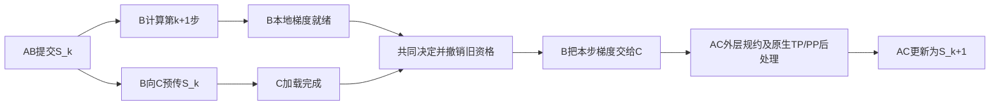

# SHIFT v2.1：v2继续优化——状态预传、本步交接与生命周期验证

保留公开v2为基线。本轮验证存活副本的计划性交接，未增加故障检测器，也不涉及DP内部节点迁移。仍使用torchFT0.2.0及原有三机H800环境，不升级库、不改变精度、batch、梯度归一化或Adam epsilon。

## 四项目标的结果

| 目标 | v2.1结果 |
|---|---|
| 状态提前到达C | 完整MoE已实现：B在第k+1步计算期间预传最新已提交状态S_k，C提前加载；没有持续追逐旧快照 |
| 接替本步规约/更新 | B完成本地DDP梯度后交给C；C首步不执行前后向，AC外层规约后继续原生TP/PP梯度处理和更新 |
| 进一步压缩等待 | 按同一A主机提交间隔实测；结果见下，不承诺绝对零等待 |
| 多轮和异常恢复 | 同一A及B/C原进程连续轮换；有限故障矩阵覆盖准备失败、超时、旧状态和首次更新前的校验拒绝 |

状态S_k在这一步更新前仍是正确起点。C拿到B的本步梯度后直接更新成S_(k+1)，因此不用等AB更新后再完整搬一次新状态。参数/Adam在只读窗口后台打包并检查Tensor版本；可能被前向改变的buffer及RNG先单独冻结，B计算后的buffer/RNG再随梯度交接。B在发送完成前不得更新，取消时也先结束读取再恢复AB更新。



切换发生在**本步第一个外层bucket发出前**，不是替换已经进行中的NCCL collective。C跳过本地DDP重复规约，保留原有外层规约之后的TP/PP处理顺序。所有dense/expert梯度桶都交接，梯度、样本角色及实际应用的尾部状态有独立审计。

## 验证与性能

| 指标：中位数 [最小, 最大]，秒 | P1f，n=5 | P2，n=5 |
|---|---:|---:|
| A最后AB提交→首个新提交 | 1.195 [1.135, 1.451] | 1.188 [1.154, 1.290] |
| 相对本次交接前正常步的额外间隔 | 0.303 [0.174, 0.601] | 0.285 [0.244, 0.401] |
| 请求→控制机观察到首个新提交 | 25.476 [24.834, 27.736] | 25.260 [24.302, 26.511] |
| 交接后50步总耗时 | 37.736 [37.284, 38.069] | 37.089 [36.188, 37.498] |
| 后49个间隔中位数 | 0.721 | 0.712 |
| 后49个间隔p95 | 0.909 | 0.863 |
| 后49个间隔最大值 | 1.265 | 1.004 |

交接间隔差值（P1f−P2）95% bootstrap区间为[-0.129, 0.263]秒，额外间隔差值区间为[-0.146, 0.316]秒，均跨0：**未证明P2稳定缩短交接等待**。后50步总耗时本次中位数少约0.65秒，但各次切换步数/样本窗口不同，只作为本负载的短窗口结果，不外推长期吞吐。

额外间隔按本次交接前最后10个正常间隔的中位数扣除，保留负值；不是直接测出的停机时间。A主机单调时钟用于提交间隔，控制机单调时钟用于端到端；不混减跨机时钟。P2的begin位于提前计算阶段，不能拿它与P1f的激活等待直接比较。

最终固定代码：3次独立完整状态审计；3轮连续完整审计；10轮连续流程/资源检查；P1f/P2各5次交替计时，每次接替后继续50步。审计含大规模CPU哈希开销，不参与性能统计。每次正式运行先核对三机6个关键工作源码SHA与本地一致。性能矩阵使用归档的固定protocol源码；随后针对学习率调度兼容性的修正单独审计，不混入计时样本。各会话原始配置、源码检查及运行日志保留。

常驻10轮验证中，24个训练worker PID保持，A连续提交162个唯一训练步，末轮后继续50步；另有3轮连续完整状态审计和3轮跨学习率调度的完整审计。代表性A rank0在首次Adam分配后，存活显存维持1,068,474,880字节；第1→9轮缓存保留量增加约14MiB，线程数94–98，未把缓存或峰值解释成泄漏。这里只验证有限轮次，未做数小时长稳。

学习率修正仅放松恢复前的动态lr兼容性比较，静态布局/参数组结构仍校验；完整optimizer/scheduler恢复正确lr。将调度周期设为5步的审计观察到6个学习率值，16个rank级恢复确实从旧lr恢复到当前lr，随后AC状态完全一致。

五类受控场景全部通过：观察到准备拒绝/3秒就绪期限后，控制器让AB再推进8步，期间完成取消处理并保留旧epoch；过期状态被拒后AB继续10步；旧资格撤销后的梯度校验拒绝，通过新epoch恢复AB继续10步，末三步状态精确一致；注入250ms训练环节延迟后完成替换并继续10步。C在四类拒绝/取消场景的有效提交均为0。

延迟校准中，P2交接间隔1.536秒，P1f为1.458秒，各只有一次、切换步不同，不作稳定优劣结论；它说明不能假设等B本步梯度总比让C计算更快。

## 异常恢复边界

- 撤销前：C准备失败/超时或状态版本被拒，放弃候选，AB保留原epoch继续。
- 撤销后、第一次新更新之前：C拒绝梯度校验，AB的参数/优化器仍是S_k，已完成的梯度也还保留；用**新Manager、新通信组、新epoch**恢复AB并完成本步。旧Manager仍被拒绝，没有复活旧句柄。
- 准备失败/超时注入位于跨副本通道创建之前；候选NCCL组创建到一半失败的自动回退未覆盖。
- 这不覆盖任意GPU/网络故障，也未实现部分optimizer更新后的通用回滚。非计划quorum变化仍可能触发候选适配器的安全拒绝。
- B注入250ms训练环节墙钟延迟的测试已经接替并继续；这不是硬件降频或自动慢故障检测。P2仍依赖B算完本步梯度，严重慢时可能不如v2的更新后交接。保留P1f路径，不宣称P2普遍更快。

## 结论与停止条件

本轮探索可收尾：状态预传、本步梯度接替、连续轮换和限定异常恢复均有完整MoE证据。**常规单次替换保留P1f为推荐路径；P2作为需要预传/本步接力、多轮及本轮受控恢复时的可选路径。** 没有稳定的进一步等待收益，不为了追逐零等待继续叠加新协议。

没有实现绝对零等待、任意故障不停顿或任意更新阶段的回滚。10轮连续验证不代表数小时/数天长稳。原v1严格FP32第二次更新的容差失败保持；本轮状态/梯度精确交接不等于已证明与不中断轨迹数值等价。完整MoE持续更新影子没有实现，本轮选择短时只读窗口预传。

## 复现及证据

```bash
python3 -m shift_full.deploy --include-node3
python3 scripts/verify_overlap_source.py tmp/deployed-v21.json
python3 scripts/run_planned_handoff.py --name UNIQUE_V21 --variant p2 --source B --audit --post-steps 6
python3 scripts/run_overlap_cycles.py --name UNIQUE_V21_CYCLES --cycles 3 --audit --post-steps 6
python3 scripts/run_planned_handoff.py --name UNIQUE_V21_REJECT --variant p2 --source B --scenario relay-reject --post-steps 10
# 离线核验公开日志：
python3 scripts/unpack_v2_evidence.py --evidence results/v2_1 --output tmp/v21-evidence
python3 scripts/analyze_overlap_cycles.py tmp/v21-evidence/v2_1_cycles3_audit02
```

`results/v2_1/summary.json`保留范围、逐会话值与固定种子bootstrap区间；`bundles/`为分会话去敏日志，`metadata.tar.gz`和`session_index.json`为配置/状态/来源，`records/`保存矩阵索引和分阶段实跑源码快照，`micro.tar.gz`为Linear验证。`manifest.json`核验公开文件，`source_manifest.json`核验当前源码。模型、张量、运行时和凭据不上传。

早期部署/日志字段不一致只作校准；多轮键前缀错误的中止轮次及一次SSH中断导致的失败尝试均保留，不计验收，也没有重写成成功。后续已强制源码一致并重跑。

学习率恢复兼容性也已补到推荐的P1f路径：另做一次跨调度变化的完整审计，8/8 rank从旧lr恢复到当前lr，状态与后续共同更新一致。两条路径均未放宽状态哈希或原数值容差。
