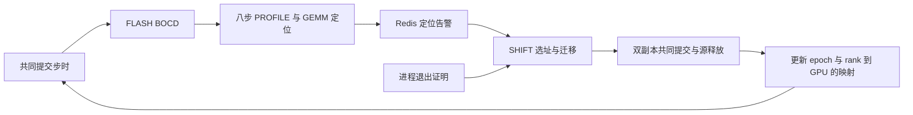

# FLASH 与 SHIFT 联动

FLASH 负责计算慢检测和定位。SHIFT 负责观察进程退出、选择替补、执行恢复或迁移并确认提交。v2 和 v4 分两场验收，分别迁整个 DP 副本和一个 DP 副本里的完整 PP 阶段。当前 v2 支持 DP1。FLASH 输出的是慢 rank，实验配置决定迁移范围。

## 接口

|方案|取舍|
|---|---|
|Redis Streams|复用 FLASH 已有 Redis。事件可重读，方便对应定位窗口、迁移请求和最终归属。选此方案。|
|Redis Pub/Sub|发布开销低，订阅端暂停期间会错过事件。|
|直接调用 SHIFT 或共用训练 Store|路径短，诊断进程需要依赖 SHIFT 的控制端点或训练 Store 生命周期。训练 Store 继续负责训练边界。|

Redis 由实验私有 Unix socket 提供，FLASH 的 CPU 推理与 SHIFT 控制器部署在同一控制主机。所有 key 按唯一 session 隔离。SHIFT 发布 `membership` 快照，包含 epoch、生效步、每个逻辑 rank 的 Pod UID、GPU UUID、actor generation 和物理主机。FLASH 把一个自动、完整、给出单一 rank 的 PROFILE 结果写入 `alerts` stream。生产者在采集前固定归属，发布前核对采集器记录的设备与当前归属。

SHIFT 检查 session、epoch、worker 身份、八步窗口及窗口末尾的共同提交进度。默认接受窗口末尾距当前进度最多 32 步的告警。相同定位窗口生成同一个请求 ID，按现有命令路径进入自动选址。Redis 不可达时训练会继续，控制器会在摘要里记录错误。当前控制器只在运行中的 session 内跟踪 stream cursor。

## 替补接入 MONITOR 和 PROFILE

SHIFT 先验证替补的 Pod 和 GPU 绑定，再等双副本共同提交和旧 actor 释放，最后更新 epoch 并发布新归属。候选准备、迁移尾部及单副本提交不进入下一轮检测。每个新 epoch 启动 FLASH 的 BOCD worker，运行上限随 SHIFT 会话配置，接管或停止时结束旧 worker。MONITOR 的 rank 0 步时样本只有在新归属下所有 rank 都完成同一步后才送出，PP1 替补也必须提供该步样本。新 epoch 按原规则积累 3 个预热步和 30 个监测样本。

实验入口增加了 SHIFT schedule 内的 8 步 GEMM PROFILE。启动参数 `--flash-calibrate` 用独立健康会话采集 rank 和 GEMM shape 参考。`--flash-live-reference` 让 BOCD 请求触发现场采集，由 FLASH 的 CPU 定位进程评分。各 rank 必须有同一窗口的完整记录，匹配率、持续性和第一二名差距不足时拒判。仅完整自动结果进入 Redis。开发注入只给指定逻辑 rank 的现有 GEMM stream 加延时，按步记录实际调用次数。

接管后继续使用同一份健康参考，在新 epoch 重新建立 MONITOR 基线。若新基线触发 PROFILE，控制器把 epoch 和采集步写入现有训练 Store。训练进程读取命令计数时一并读取采集计划。窗口至少领先两个 DP 副本中最新的已提交进度三步。原生探针等上一个窗口结束后重置采样计数，为新 epoch 建立独立输出目录。采集完成必须对应新归属和八个实际提交步，迁移中断或跳过提交则拒绝该窗口。候选 actor 加入后和仍在运行的 actor 一起参与 PROFILE。

该实验定位器复用 FLASH 的 GEMM 特征，沿用 v4 的鲁棒非负回归，以 FLOPs、数据量和固定开销预测同类 GEMM 的耗时。SHIFT 用独立健康 PROFILE 训练系数和 rank 归一化基线，对样本不足的计算类型回退到同 rank 的健康 shape 时间。历史冻结定位器还要求非 GEMM kernel 证据。本轮 CUDA 13 下未观测到该分支的 kernel 样本，故冻结模型的原始准确率与本轮 GEMM 结果分别报告。

v1 Lab replay 在提交边界让源进程退出，SHIFT 核对 supervisor 的 PID 和退出码才释放恢复。普通运行中意外退出仍会结束 session。支持任意步意外退出需要定义健康副本的共同回滚点，并验证故障出现在提交投票或 NCCL 执行中途时的行为。

预准备 v1 在源退出前完成替补初始化。恢复过程里的双副本梯度归约等同一 quorum 和训练步的梯度就绪，再启动短 NCCL 超时。两 runner 首试在状态传完后发生投票分歧并退出，加入就绪同步后，同配置复测通过。第一个双副本归约前最长等待 3.74 秒。退出观察至共同提交为 12.56 秒，请求至共同提交为 31.27 秒。退出前的预准备缩短了故障后的等待，完整时延仍包含这部分准备。

## 复现和证据

- 两台物理主机只用 `gpu-01` 和 `gpu-03`。FLASH 双 runner 为 8+8，三 runner 为 8+4+4，后两组同在 `gpu-03`。三 runner 使用 IB 跨 Pod，关闭 NCCL SHM 和 P2P。SHIFT 三 runner 为 4+4+4，每个独立 Pod。跨主机迁移以源和目标的物理主机字段为准。
- FLASH Lab Job 入口在 FLASH1022 的 `deploy/lab/v4_jobs.py`，对应探针补丁和辅助文件见 [FLASH1022 companion files](../integrations/flash1022/README.md)。以相同模型、布局、序列和步数比较 OFF、MONITOR、PROFILE 的步时。计算慢模拟需核对实际注入次数和采集窗口。实卡降频探针在空闲的分配卡上被 NVML 拒绝。Lab 准入也拒绝额外的调频能力。本轮实测继续使用模拟注入。
- SHIFT 控制器使用 `--flash-redis-socket` 与 `--flash-slow-policy v2|v4`。CPU 推理端用 `python -m scripts.flash_bridge` 的 `pin` 和 `publish`。后者接收预测 JSON、FLASH rank 到 SHIFT 逻辑 rank 的一对一映射，以及采集器按 FLASH rank 写出的 `pod_uid` 和 `gpu_uuid`。
- `scripts.run_flash_shift_lab` 支持 v1 预布置退出、v2/v4 定位回放、健康 PROFILE 校准和现场 BOCD→PROFILE→Redis。部署 Lab runner 后，在 `node0` 所在物理主机启动控制器。每次使用唯一 session。证据位于 `evidence/flash_shift/`。

## 开销口径

历史目标为 MONITOR <1%、PROFILE <5%，PROFILE 每 rank 最多 8 步、30 秒、1 MiB。每组健康对照使用相同步数和布局。分别记录训练步时、8 步窗口和启动至收尾墙钟。共享环境里的单次负增量保留为实测波动，无法用于证明稳定满足阈值。

旧 FLASH R98 的正例使用 seq256、比例 6、32 步 CUDA stream 计算延时，每步 1 秒、每场注入 30 秒上限。本轮旧注入器在 CUDA 13 探针中未记录到实际 launch 延时。实验改为在可观测 cuBLASLt 调用的同一 stream 内注入有界延时，并固定采样率。模拟效果按实际步时退化、注入覆盖、自动触发和定位四项记录。

## SHIFT 实测

初轮验收使用 GPU01 与 GPU03 的三个独立 runner，初轮迁移均由 GPU01 到 GPU03。单场使用 8 个活跃 rank 和 4 个备用槽位，TP1/PP2/EP2、seq32、CPU AdamW。

|实验|完成的范围|首次共同提交|接管后 BOCD 样本|
|---|---|---:|---:|
|v1 受控退出两场|DP0、DP1 各四 rank|退出观察后 25.73–27.00 s|40、40|
|v2 现场|定位 rank 6，迁 DP1 四 rank|迁移请求后 32.83 s|41|
|v4 现场|定位 rank 4，迁 DP1/PP0 两 rank|迁移请求后 30.66 s|40|
|Redis 回放三场|v2 DP1、v4 DP1/PP1 和 DP0/PP0|迁移请求后 27.00–29.40 s|40–41|

现场 v2 和 v4 的 PROFILE 均为第 44–51 步，全部 rank 完整。BOCD 请求到 Redis 告警分别为 41.11 和 34.71 秒，采集导出与 CPU 推理分别用时 0.43 和 0.47 秒。恢复后平均最大 rank 步时，v2 从 2.213 降到 2.147 秒，v4 从 2.080 到 2.076 秒。七场都通过独立审计，接管后的 BOCD 均未触发。重复投递的旧 epoch 告警被拒绝。

同样 40 步的 SHIFT OFF、MONITOR、PROFILE 由控制器启动到退出分别为 111.30、109.76、109.20 秒。匹配 PROFILE 窗口的最大 rank 步时总和分别为 18.33、17.64、17.54 秒。三场均覆盖所有共同提交，单次共享负载样本无法给出稳定的开销上限。

两 runner 补测按 OFF、MONITOR、PROFILE、PROFILE、MONITOR、OFF 顺序运行。用每步八个 rank 的最大共同提交间隔求和，两次 OFF 相差 0.41%。相对 OFF 均值，MONITOR 两次分别增加 3.72% 和 4.55%，PROFILE 的八步窗口分别变化 +1.98% 和 −4.62%。

第二次 MONITOR 的健康训练在第 36 步触发请求。该窗口里的自然步时退化为 12.5%。两份独立健康 PROFILE 对照均由 GEMM 定位器拒判。当前一个 epoch 内只处理一次 BOCD 请求，定位拒判后该 epoch 缺少下一次检测机会。建议保留 FLASH 检测器和阈值，在 SHIFT 为拒判后的标准 MONITOR 加冷却和重新采集，并用同一 epoch 先拒判后故障的对照验证。

## 接管后再定位与迁移

三 runner 的连续 v4 实验中，在 GPU01 上首次注入逻辑 rank 4。接管后在 GPU03 的同一逻辑 rank 再注入。两次都定位到 rank 4，迁移范围始终是 DP1/PP0 的 rank 4–5。迁移路径为 GPU01 → GPU03 → GPU01。两次迁移均通过共同提交和源 actor 释放审计。最后的健康 epoch 有 42 个 MONITOR 样本，没有再次触发。

|故障 epoch|PROFILE 窗口|BOCD 请求至告警|收集及 CPU 定位|迁移请求至共同提交|
|---:|---:|---:|---:|---:|
|0|42–49|33.11 s|0.44 s|28.98 s|
|1|104–111|34.57 s|0.60 s|26.39 s|

首次采集较初轮相同场景提前两个训练步。另两场在三 runner 上覆盖 DP1/PP1 和 DP1/PP0 两个注入位置。

|现场试验|定位 rank|实际迁移|BOCD 请求至告警|迁移请求至共同提交|
|---|---:|---|---:|---:|
|v4 DP1/PP1|6|rank 6–7|34.29 s|27.12 s|
|v2 DP1/PP0|4|rank 4–7|33.27 s|27.40 s|

三场的摘要分别在 `evidence/flash_shift/flash_v6_repeat_v4a.json`、`flash_v6_live_v4b.json` 和 `flash_v6_live_v2a.json`。这批补测的注入在 handoff 开始时停止，后续另测了持续到源 actor 退役的注入。

两 runner 试验将备用 GPU 放在 GPU03 的现有 runner 内。DP1/PP1 使用每次 12 ms、每步最多 64 次的较弱注入，BOCD 观测到 23.9% 退化并在第 41 步触发。第 45–52 步的 PROFILE 定位 rank 6。PP 阶段跨节点迁移后有 41 个健康样本。请求至告警和迁移请求至首次共同提交分别为 27.25 和 26.35 秒。证据见 `evidence/flash_shift/flash_v6_two_v4m.json`。

两 runner 的持续慢故障 v2 在迁移第 56–59 步仍执行了延时。FLASH 定位 rank 4，SHIFT 迁移整个 DP1。BOCD 请求至告警用时 31.56 秒，迁移请求至首次共同提交用时 29.11 秒。两组 Lighthouse 并行启动后，迁移请求至替补预检用时 2.06 秒，早期串行试验为 3.59–3.88 秒。两组实验的 runner 布局有差异。证据见 `evidence/flash_shift/flash_v6_persistent_v2.json`。

两 runner 的连续 v4 在两个 epoch 都定位 rank 4。旧 actor 分别在第 55–56 步和 116–117 步继续执行注入，随后完成迁移。请求至告警为 31.36、32.73 秒，请求迁移至共同提交为 27.97、27.30 秒。故障中最后六步平均最大 rank 步时为 3.08、3.16 秒，恢复后第 11–32 步为 2.05、2.01 秒。第二次接管后的 MONITOR 有 40 个健康样本。证据见 `evidence/flash_shift/flash_v6_persistent_v4.json`。

迟发对照第 85 步注入，BOCD 在启动 179.04 秒后、第 88 步触发，超过旧默认的 150 秒上限。第 92–99 步的 PROFILE 定位 rank 6。迁移请求后 28.03 秒双副本首次共同提交。证据见 `evidence/flash_shift/flash_v6_late_v4.json`。

## FLASH 独立复跑

双 runner 与三 runner 各跑了 `legacy` 和 `node_local_pp`。四场强模拟均在 rank 12 的 32 步内执行 2,304 次延时，BOCD 在第 38–42 步触发，16 rank 的第 44–51 步 PROFILE 均完整且无丢弃。GEMM 回归四场均定位 rank 12，其中三场核对了推理出结果后训练继续推进。三 runner 的 `node_local_pp` 在 SSH 重连后导出并评分。弱模拟、启动失败及早期定位拒判均保留。

|runner|布局|MONITOR 训练墙钟相对 OFF|PROFILE 8 步相对 OFF|PROFILE 8 步相对 MONITOR|
|---:|---|---:|---:|---:|
|2|legacy|+0.72%|+2.15%|+0.63%|
|2|node_local_pp|+0.82%|+2.95%|+0.27%|
|3|legacy|+2.35%|+6.13%|+3.71%|
|3|node_local_pp|−0.56%|+3.33%|+8.08%|

相对 OFF，PROFILE 整次训练墙钟的增量为 0.75%–3.51%。双 runner 的 legacy 启动器全程 MONITOR 增量为 1.97%。当前结果仍有超过旧指标的对照。完整启动器时间、逐场步时、校验与未达标记录见 `evidence/flash_shift/flash_v4_baseline_20261112.json`。

三 runner 再用首尾 OFF 夹住 MONITOR 和 PROFILE，两个布局均跑完 40 个正式训练步。两次 PROFILE 都覆盖 16 个 rank 的 8 步，仍无 CUDA 13 非 GEMM kernel 样本。

|布局|MONITOR 训练墙钟相对 OFF 均值|PROFILE 8 步相对 OFF 均值|两次 OFF 墙钟变化|
|---|---:|---:|---:|
|legacy|−3.12%|−1.48%|+2.00%|
|node_local_pp|+0.54%|−1.92%|−6.46%|

legacy 健康对照在第 42 步生成一次 BOCD 请求，训练在第 43 步结束，控制日志无 PROFILE 启动。时间从原始日志重算，分别记录采集是否启动和健康校验是否通过。证据见 `evidence/flash_shift/flash_v6_three_runner_perf.json` 和 `flash_v6_three_runner_timing.json`。
